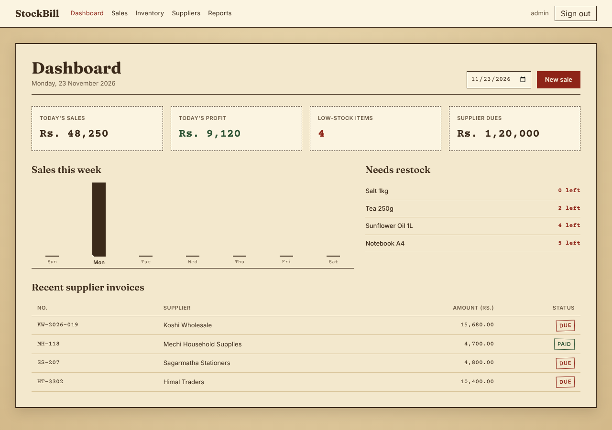
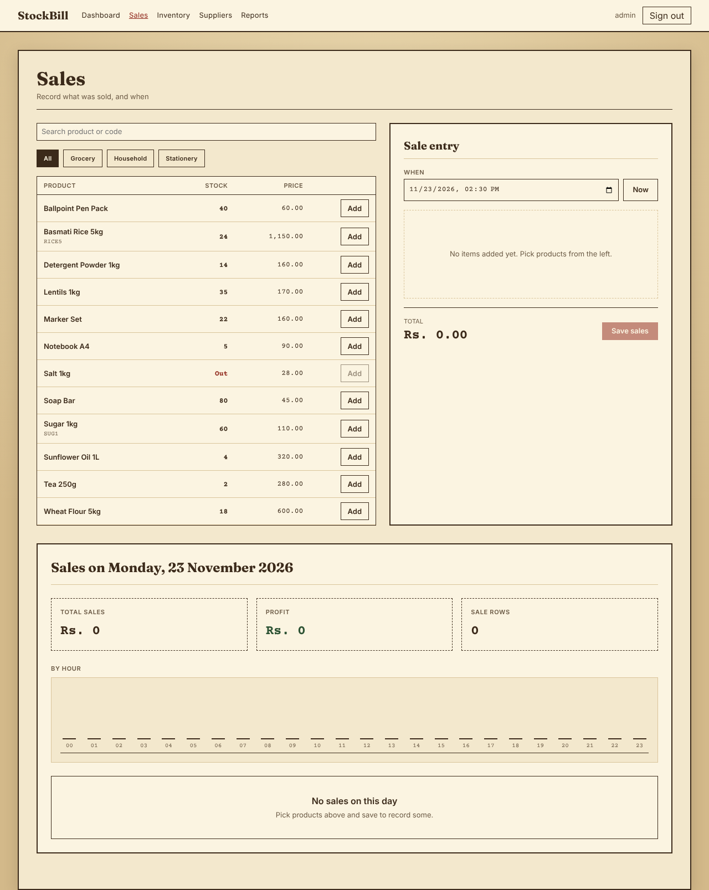
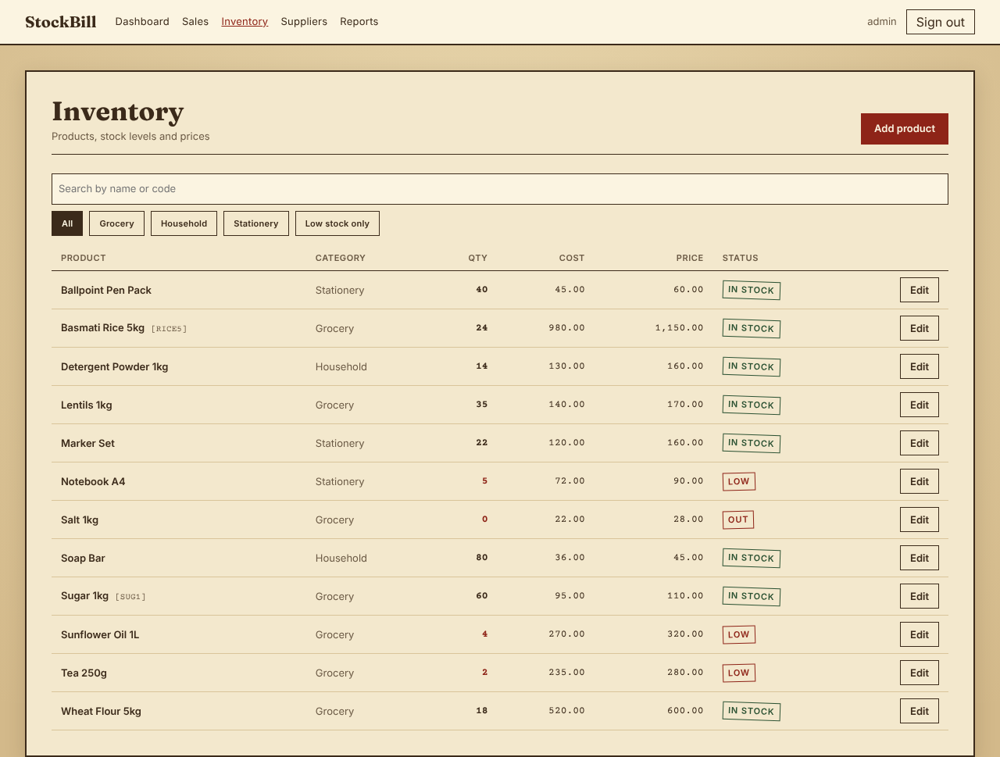
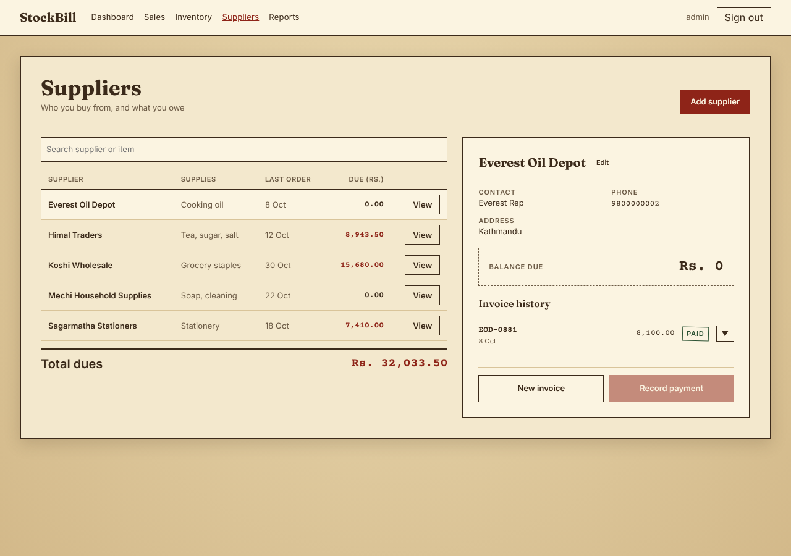
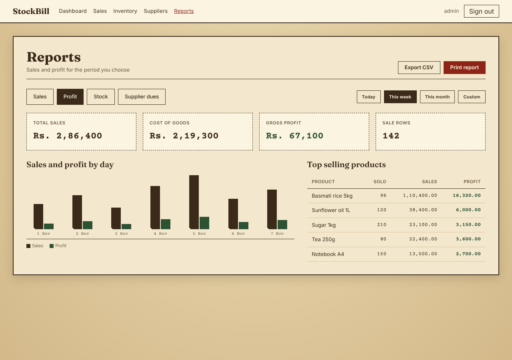

# StockBill

[](https://github.com/Mainali1/StockBill-Stock-inventory-billing-system/actions/workflows/release.yml)

StockBill is an offline desktop stock-keeping manager for a single shop. The owner keeps a product
list with cost, price, quantity and reorder level; records invoices received from suppliers (which
add stock and create amounts owed); records what was sold, per item, at a chosen date and time
(which removes stock); and reads a dashboard and reports for any day or range. There are no
customers, no payment methods, no tax and no receipts. It is one offline program with a single owner
account.

## Features

| Screen | What the owner can do |
|---|---|
| Setup and Login | Create the shop and the single owner account on first launch, then sign in. Five wrong passwords lock the form for 30 seconds. |
| Dashboard | See sales, profit, low-stock items and supplier dues for any date, this week's sales by day, the products that need restocking, and the latest supplier invoices. |
| Inventory | Search products by name or code, filter by category or low stock, add and edit products with cost, price, quantity and reorder level, and delete or archive them. |
| Suppliers | Keep supplier contacts, record supplier invoices (which add stock and create an amount owed), and record payments (which settle the oldest unpaid invoices first). |
| Sales | Record what was sold at a chosen date and time, see the day's total, profit and hour-by-hour chart, and edit or delete a sale with the stock put back. |
| Reports | Sales, Profit, Stock and Supplier dues for today, this week, this month or a custom range, with CSV export and a print layout. |

## Screenshots

Taken from `npm run dev:web` (the browser mock API), so the figures are sample data.

| | |
|---|---|
|  |  |
|  |  |
|  | |

## Download

Packaged installers for each release are available on the [GitHub Releases](https://github.com/Mainali1/StockBill-Stock-inventory-billing-system/releases) page:

- **Windows**: `StockBill-<version>-win-x64.exe` (NSIS installer).
- **Linux**: `StockBill-<version>-linux-x86_64.AppImage` (standalone AppImage). Make it executable (`chmod +x`) and run.
- **macOS**: `StockBill-<version>-mac-arm64.dmg` (Apple Silicon DMG).

### Unsigned installer warning

Installers are unsigned. This is intentional for this academic project. Your operating system may display a security prompt when opening the installer for the first time:

- **Windows (SmartScreen)**: Click **More info**, then click **Run anyway**.
- **macOS (Gatekeeper)**: Right-click (or Control-click) the application in Finder and select **Open**, then confirm by clicking **Open** in the dialog.

## Requirements

- Node 22 (`>=22`) and npm. The version is pinned in `.nvmrc`.

## Install

```
npm ci
```

`npm ci` installs exactly the versions in `package-lock.json`.

## Run

```
npm run dev
```

This rebuilds the native SQLite module for Electron and opens the desktop window.

To run the renderer in a normal browser with an in-memory mock API (no Electron):

```
npm run dev:web
```

The URL query string picks the mock auth state: `?state=setup`, `?state=login` or the default
signed-in state.

## Test

```
npm test
```

This rebuilds the native module for plain Node and runs the Vitest suite in two projects: `main`
(Node) for the database, IPC and shared code, and `renderer` (jsdom) for the React screens.

## Native module note

`better-sqlite3` is a native module that must be built for either plain Node or Electron.

- `npm run rebuild:node` builds it for plain Node. Tests and the seed script need this.
- `npm run rebuild:electron` builds it for Electron. The desktop app needs this.

`npm run dev` runs `rebuild:electron` first, and `npm test` and `npm run seed:demo` run
`rebuild:node` first, so the right build is always in place. Run them again if you switch between
the app and the tests by hand.

## Seed demo data

```
npm run seed:demo
```

This recreates a demo database (default `./demo/stockbill-demo.db`, overridable with `--out <path>`)
with a demo user (`admin` / `admin12345`), demo shop name ("Demo Mart"), suppliers, products, and
initial data. Point the app at it with the `STOCKBILL_DB` environment variable:

```bash
STOCKBILL_DB=./demo/stockbill-demo.db npm run dev
```

The `STOCKBILL_DB` environment variable overrides the default database path in `src/main/index.ts`
(used for testing and demo inspection; the packaged app ignores it unless set).

## Run the demo

Create the demo database, start the app on it, and follow the walkthrough in
[`docs/demo-script.md`](docs/demo-script.md). Sign in with `admin` and `admin12345`.

```
npm run seed:demo
STOCKBILL_DB=./demo/stockbill-demo.db npm run dev
```

## Requirements and documents

Every requirement in [`docs/SPEC.md`](docs/SPEC.md) has an ID such as `SAL-2`, and the tests carry the
ID at the start of their names. `npm run trace` regenerates [`docs/requirements-trace.md`](docs/requirements-trace.md),
a table of each requirement with its tests and screen. `tests/docs.test.ts` fails if a requirement has no
test or if the schema document and the ER diagram no longer match the database.

| Document | Content |
|---|---|
| [`docs/er-diagram.md`](docs/er-diagram.md) | Tables, columns and relationships, with the money and date formats |
| [`docs/use-case.md`](docs/use-case.md) | The owner's use cases and the requirements behind them |
| [`docs/architecture.md`](docs/architecture.md) | Layers, the trust boundary, security and testing |
| [`docs/gantt.md`](docs/gantt.md) | Project timeline |
| [`docs/schema.sql`](docs/schema.sql) | The database schema produced by the migrations |
| [`docs/requirements-trace.md`](docs/requirements-trace.md) | Requirement to test to screen table |
| [`docs/demo-script.md`](docs/demo-script.md) | Viva walkthrough |
| [`docs/release-process.md`](docs/release-process.md) | How a release is built and published |

## Security

- Every query is a prepared statement with bound parameters. There is no ORM and no query is built by joining user text.
- Passwords are stored only as bcrypt hashes, and no handler returns one.
- The window runs with context isolation, no Node integration and the sandbox on. The renderer can only call named IPC channels.
- The main process validates every input with zod and checks the session before it touches data.

## Project layout

```
src/main/        Electron main process
  db/            connection, numbered SQL migrations, repositories
  domain/        pure functions and errors
  ipc/           one file per feature; each handler validates input and checks the session
  index.ts
src/preload/     typed contextBridge API
src/renderer/    React app (pages/, components/, styles/, dev/ mock layer)
src/shared/      DTO types and IPC channel names shared by main and renderer
scripts/         seed runner and one-off scripts
tests/           release configuration and documentation tests
docs/            specification, tracker, diagrams, trace table, demo script, screenshots
```

## Scripts

| Script | What it does |
|---|---|
| `dev` | Rebuild for Electron, then run the desktop app |
| `dev:web` | Vite dev server for the renderer only, with the mock API |
| `build` | Build main, preload and renderer into `out/` |
| `dist` | Build, then package installers with electron-builder into `dist/` |
| `typecheck` | `tsc --noEmit` for every tsconfig project |
| `lint` | Run ESLint over the repository |
| `format` | Run Prettier over the repository |
| `test` | Rebuild for Node, then run Vitest |
| `verify` | `typecheck`, then `lint`, then `test` |
| `rebuild:node` | Rebuild `better-sqlite3` for plain Node |
| `rebuild:electron` | Rebuild `better-sqlite3` for Electron |
| `seed:demo` | Recreate the demo database |
| `schema:dump` | Regenerate `docs/schema.sql` from the migrations |
| `trace` | Regenerate `docs/requirements-trace.md` from the spec and the test names |
