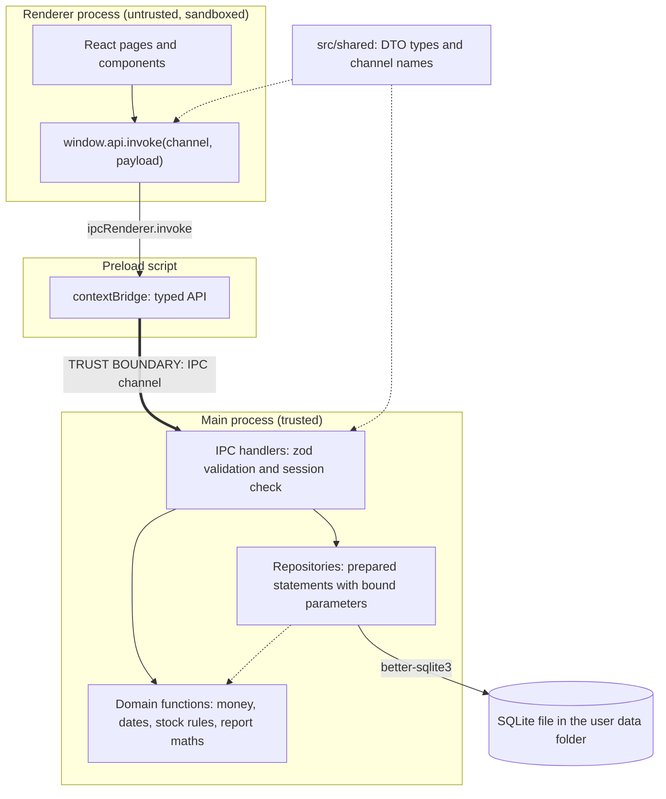

# Architecture

StockBill is an Electron desktop app. The user interface runs in a restricted renderer process and
never touches the database. Everything that reads or writes data happens in the main process, behind
a small set of named IPC channels.

The thick arrow is the trust boundary. Anything that arrives from the renderer is treated as untrusted
input until the main process has validated it. The dotted lines show compile-time sharing of types, not
runtime calls.

## Layers

| Layer | Folder | Responsibility |
|---|---|---|
| Renderer | `src/renderer/` | Screens, components and styles. Calls `window.api` only. It cannot import Node, Electron or database code (enforced by an ESLint rule). |
| Preload | `src/preload/` | Exposes one function, `invoke`, to the page through `contextBridge`. |
| IPC handlers | `src/main/ipc/` | One file per feature. Each handler validates its input with zod, checks the session, calls repositories and domain functions, and turns errors into a result object. |
| Domain | `src/main/domain/` | Pure functions with no Electron or file system imports: money, date helpers, stock status, dashboard and report aggregation, CSV building. |
| Repositories | `src/main/db/repositories/` | Raw SQL as prepared statements. Multi-table changes run in one transaction. |
| Database | `src/main/db/` | Connection, numbered SQL migrations bundled into the build, and the file `stockbill.db` in `app.getPath('userData')`. |
| Shared | `src/shared/` | The IPC contract: channel names and the input and output type of each channel. |

## Security

- **Parameterized SQL only.** Every query is a prepared statement with bound parameters. User text is never
  joined into SQL. There is no ORM or query builder. Search text goes through `escapeLike` so `%` and `_`
  are matched literally.
- **Passwords.** Stored only as bcrypt hashes (cost 10). No handler returns a password or a hash. Login
  failures show one generic message, and five failures in a row lock the form for 30 seconds in the main
  process. A dummy hash comparison keeps the timing the same when the username does not exist.
- **Context isolation.** The window is created with `contextIsolation: true`, `nodeIntegration: false` and
  `sandbox: true`. The page can only call the functions the preload script exposes. Navigation away from
  the app is blocked and external links open in the system browser.
- **Input validation.** Every handler parses its input with a zod schema before doing anything. Invalid
  input returns a `VALIDATION` result with a message per field.
- **Authentication.** Every handler except the setup check, setup, login and get-app-version rejects a call
  that has no session. The session lives in the main process and is cleared by logout.
- **Injection tests.** Payloads such as `' OR '1'='1` and `'; DROP TABLE users; --` are tested to confirm
  they never log in and never change data (AUTH-5).

## Testing

| What | Where | How |
|---|---|---|
| Pure functions (money, dates, stock status, aggregation, CSV) | `src/main/domain/*.test.ts` | Plain Vitest, no database. |
| Repositories and handlers | `src/main/db/**`, `src/main/ipc/*.test.ts` | Real migrations on a `:memory:` database. Handlers are called through `createHandler`, so no Electron window is needed. |
| IPC contract | `src/shared/ipc/channels.test.ts`, `src/main/ipc/guard.test.ts` | The channel list matches the contract and every channel registers exactly once. |
| Screens | `src/renderer/**/*.test.tsx` | Testing Library with jsdom against the browser mock API in `src/renderer/dev/mock/`. |
| Demo seed | `scripts/seed/*.test.ts` | The seed runs on `:memory:` and stock matches the plan. Every dashboard and report view has data. |
| Release configuration | `tests/release-config.test.ts` | Workflow scripts exist, `electron-builder.yml` is valid, and the README and release document have the required content. |
| Documentation | `tests/docs.test.ts` | `schema.sql` and the ER diagram match the migrated database, and every requirement ID has a test. |

`npm run verify` runs the type check, the linter and all of these tests. Pull requests run it on Ubuntu and
Windows.
