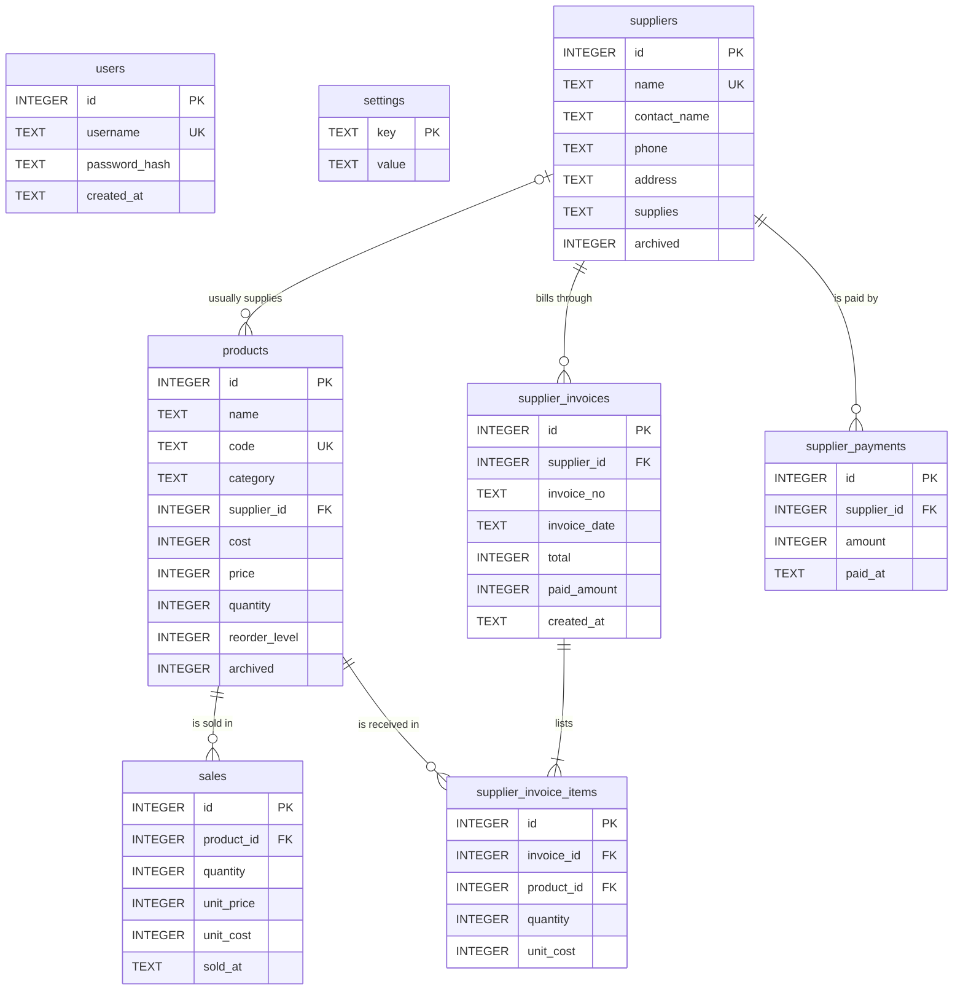

# Entity relationship diagram

The database has eight tables. The exact column definitions, constraints and indexes are in
[`schema.sql`](schema.sql), which mirrors the migrations. `tests/docs.test.ts` fails if this diagram
and the migrated schema disagree about a table or a column.

## Reading the diagram

- `users` and `settings` have no relations. There is one owner account, and `settings` holds
  key and value pairs such as `shop_name`.
- A product may have no supplier, because `products.supplier_id` is optional. That is why the
  supplier to product line starts with the "zero or one" mark. Every other foreign key is required.
- A supplier invoice must list at least one item (SUP-3), so its line to
  `supplier_invoice_items` is "one or more".
- `UK` marks a unique column. `products.code` is unique but optional.
- Derived values are never stored: product status (OUT, LOW, IN STOCK), supplier due, and invoice
  status (PAID or DUE) are calculated from the columns above.

## Money and date-time formats

All money columns (`cost`, `price`, `unit_price`, `unit_cost`, `total`, `paid_amount`, `amount`)
are whole numbers of **paisa**, so Rs. 1,200.50 is stored as `120050`. This avoids rounding errors
that appear when money is stored as a decimal. The screens convert to rupees only at the edge, using
`Intl.NumberFormat('en-IN')`.

Date-times are stored as local-time text in the form `YYYY-MM-DD HH:MM` with no time zone
(`sales.sold_at`), and dates as `YYYY-MM-DD` (`supplier_invoices.invoice_date`). Because the
Sales screen lets the owner choose any date and time, grouping a day or an hour is done with
simple string functions on these values. A `CHECK` constraint on each column rejects any other shape.
