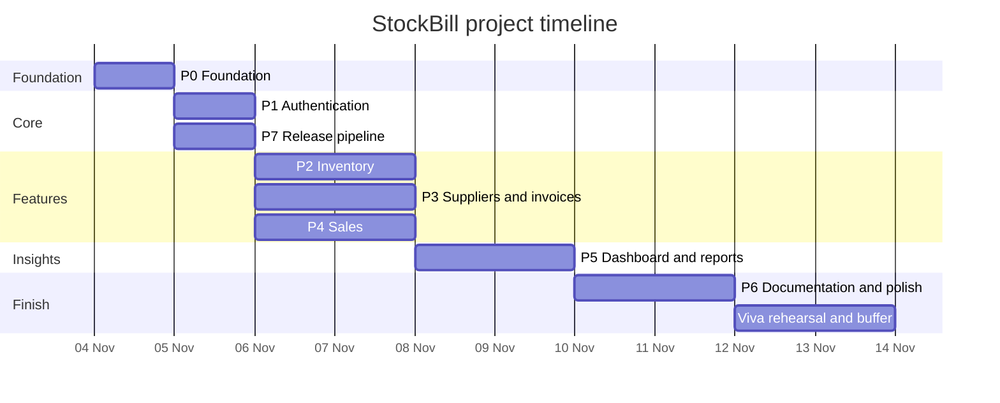

# Project timeline

The planned schedule, one bar per phase of [`TRACKER.md`](TRACKER.md). The tracker's agent log records
the day each phase was actually finished.

## Notes

- P1 and P7 are planned for the same day because the release pipeline only touches `.github/`,
  `electron-builder.yml`, `tests/`, the release document and the README download section.
- P2, P3 and P4 are independent of each other and run in parallel. They only add feature files, because the
  shared router, navigation bar, design tokens and components are finished in P0.
- P5 reads the data created by P2, P3 and P4, so it starts after them.
- P6 comes last because the documents describe the finished system. `tests/docs.test.ts` checks the ER diagram,
  `schema.sql` and the requirements trace against the real database and the real tests.
- The last two days are kept free to rehearse the viva with [`demo-script.md`](demo-script.md) and as a buffer.
