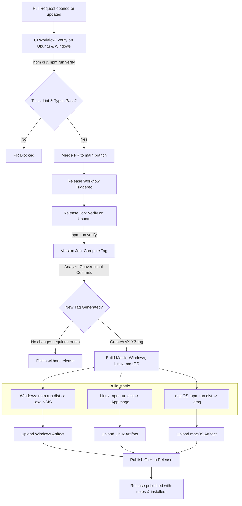

# StockBill Release Pipeline

This document outlines the continuous integration, semantic versioning, and multi-platform packaging pipeline for StockBill.

## Pipeline Flowchart

The following Mermaid diagram traces the path of code changes from pull request to a published GitHub Release:



## Commit Types and Semantic Version Bumping

StockBill strictly follows the [Conventional Commits](https://www.conventionalcommits.org/) specification. The `release.yml` workflow utilizes `mathieudutour/github-tag-action` to parse commit messages since the last git tag and determine the next semantic version number:

| Commit Type / Marker | Description | Version Bump |
|---|---|---|
| `feat:` / `feat(...)` | A new user-facing feature or functional addition | **Minor** (`X.Y.Z` -> `X.Y+1.0`) |
| `fix:` / `fix(...)` | A bug fix or defect correction | **Patch** (`X.Y.Z` -> `X.Y.Z+1`) |
| `test:` / `test(...)` | Adding or correcting tests without production logic change | **Patch** (`X.Y.Z` -> `X.Y.Z+1`) |
| `docs:` / `docs(...)` | Documentation changes only | **Patch** (`X.Y.Z` -> `X.Y.Z+1`) |
| `refactor:` | Code changes that neither fix a bug nor add a feature | **Patch** (`X.Y.Z` -> `X.Y.Z+1`) |
| `ci:` / `build:` / `chore:` | Pipeline, build scripts, or repository tooling updates | **Patch** (`X.Y.Z` -> `X.Y.Z+1`) |
| `BREAKING CHANGE:` or `feat!:` / `fix!:` | Any change introducing incompatible API or behavioral breaks | **Major** (`X.Y.Z` -> `X+1.0.0`) |

*(Note: Pushes to `main` that exclusively modify documentation paths like `docs/**`, `design/**`, or `**/*.md` are ignored by `release.yml` triggers.)*

## Why Version Bumps Are Never Committed

In StockBill, `package.json` contains `"version": "0.0.0"` permanently within the repository.

1. **Single Source of Truth**: The release pipeline computes version numbers dynamically and deterministically from git commit history and tags.
2. **Prevent Merge Conflicts**: In multi-branch and multi-contributor workflows, committing version bumps causes frequent git conflicts on `package.json` and `package-lock.json`.
3. **Build-Time Stamping**: When `release.yml` runs, it checks out the tagged commit and executes:
   ```bash
   npm version "${{ needs.version.outputs.new_version }}" --no-git-tag-version --allow-same-version
   ```
   This injects the dynamic semantic version directly into `package.json` exclusively inside the build runner environment. `electron-builder` then packages this stamped version into the installer artifacts (`StockBill-<version>-<os>-<arch>.<ext>`) and Electron's runtime `app.getVersion()`. The git tree itself remains clean and devoid of synthetic version-bump commits.
