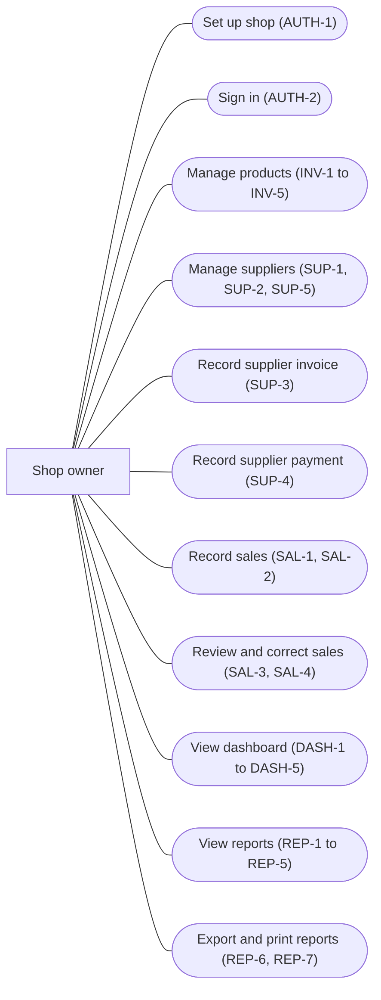

# Use cases

StockBill has one actor, the shop owner. Each use case below lists the requirement IDs from
[`SPEC.md`](SPEC.md) that define it. [`requirements-trace.md`](requirements-trace.md) shows the test
files behind each ID.

Mermaid has no native use-case notation, so this flowchart follows the standard layout: the actor on
the left, linked by plain lines to rounded use-case nodes.

## How the use cases connect

- **Set up shop** runs once, on first launch, and signs the owner in. Every later start uses **Sign in**.
  Session checks on every other screen are covered by AUTH-3.
- **Record supplier invoice** adds stock and creates an amount owed. **Record supplier payment** reduces
  that amount, oldest invoice first.
- **Record sales** removes stock. **Review and correct sales** edits or deletes a sale row and puts the
  stock difference back.
- The dashboard and the reports only read data. They show the effect of the use cases above.
